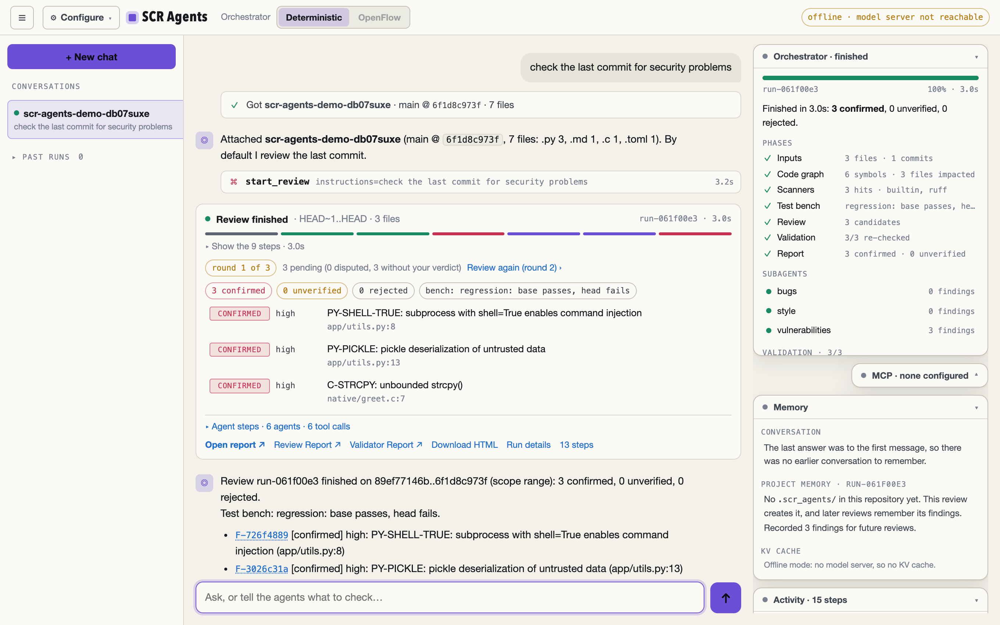
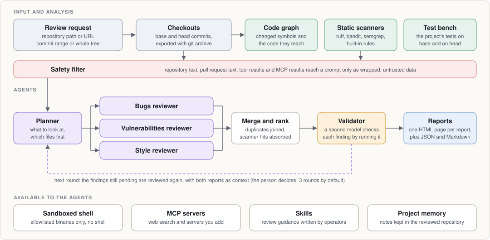
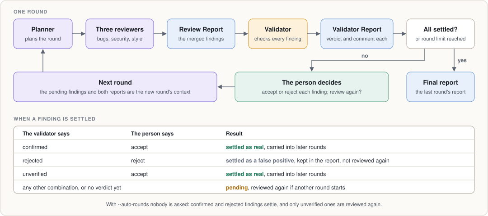
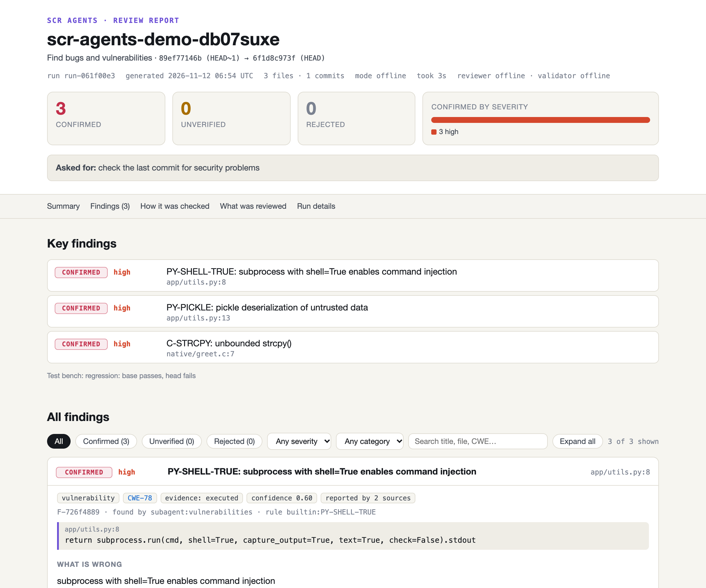
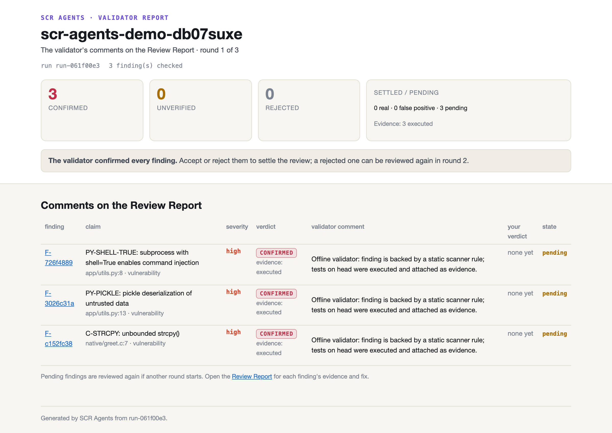
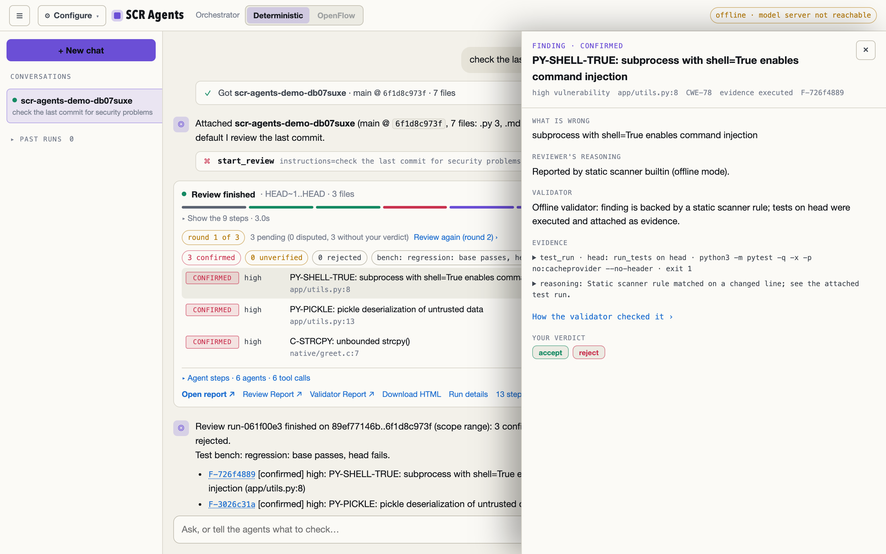

# SCR Agents: sovereign agentic secure code review

A self-hosted, multi-agent code reviewer. Point it at a git repository and a commit range (or the
whole tree) and it reports bugs, vulnerabilities and style problems. Every finding is checked a
second time by a different model that can build the code, run its tests and run a proof of concept
in a sandbox, so the report says what was actually confirmed and what was not.

Everything runs on your own machines: the models are served locally (vLLM, SGLang or any
OpenAI-compatible server) and no online model API is called.



## What it does

- **Reviews a change or a whole repository** from a local path or a git URL, optionally with a pull
  request's text and a claim to verify ("this commit fixes the overflow in `parse_header`").
- **Three reviewers in parallel** (bugs, vulnerabilities, style), briefed by a planner that has
  the code graph, the static scanner results and the test results of both commits.
- **A validator on a second model** re-checks each finding with its own tools and marks it
  `confirmed`, `rejected` or `unverified`, with the evidence it collected.
- **Review rounds**: when findings are rejected, unverified or disputed, you decide whether the
  agents review those again, with the earlier reports as context.
- **Reports** as one self-contained HTML page each, plus JSON and Markdown.
- **A web console and a terminal chat** where you ask in plain language and watch the agents,
  their tool calls and the findings live.
- **Extensible without code changes**: add review guidance as skills and tools as MCP servers.

## How it works



1. The request is turned into two read-only checkouts, the base and the head commit.
2. A code graph finds what the change touches, static scanners run on it, and the test bench runs
   the project's tests on both commits.
3. Everything that comes from the repository, a pull request, a tool or an MCP server passes the
   safety filter and reaches a prompt only as wrapped, untrusted data.
4. The planner briefs the three reviewers, which work in parallel with read, search and shell
   tools. Their findings are merged, joined with the scanner hits and ranked.
5. The validator checks every finding on a second model, by reading the code and running commands
   in a sandbox that allows a fixed list of binaries and no shell.
6. The run writes its reports and a complete record of every model, tool and MCP call.

## Quick start

You need [uv](https://docs.astral.sh/uv/getting-started/installation/) and git. uv installs the
pinned Python 3.12 by itself.

```bash
uv sync
uv run scr-agents demo --mode offline
```

The demo creates a small repository with planted defects, reviews its last commit and prints where
the reports are. `--mode offline` uses a rule-based stand-in for the models, so it needs no GPU and
no network; it is what the test suite runs on.

To try the web console the same way:

```bash
uv run scr-agents --mode offline serve
```

Open the printed URL (it carries the access token), choose **Try the demo repository** and ask for
a review.

## Use your own models

The agents talk to an OpenAI-compatible server. The defaults prefer Gemma 4 31B for the reviewers
and Llama 3.x 70B for the validator; any model with working tool calls and JSON output will do.

```bash
# serve a model, for example with vLLM
vllm serve google/gemma-4-31B-it --port 8000 \
    --enable-auto-tool-choice --tool-call-parser gemma4 --reasoning-parser gemma4

# check that the server does tool calls and JSON output
uv run scr-agents llm check

# review a commit range, a whole repository, or chat about one
uv run scr-agents review --repo /path/to/repo --base main --head HEAD
uv run scr-agents review --repo . --base HEAD --head HEAD --scope all
uv run scr-agents chat https://github.com/org/repo
uv run scr-agents serve
```

The full server flags for vLLM and SGLang, including the chat templates, are in the
[overview](docs/scr_agents/overview.md). Settings live in a YAML file passed with `--config` (the tracked template is
`deploy/scr_agents.yaml`): the reviewer server and model, a second server and model for the
validator, the scanners, the sandbox allowlist and the round limit. `python3 deploy/setup.py`
writes a config and the model server start scripts for a GPU server interactively.

## Review rounds



Each round produces two pages: the **Review Report** (the reviewers' merged findings) and the
**Validator Report** (the validator's verdict and comment on each one). A finding is settled when
you agree with the validator. If some are not, the console and the chat ask whether to review them
again; the next round starts from the planner with the pending findings and both reports as
context. Three rounds are allowed by default (`review.max_rounds`).

```bash
uv run scr-agents verdict --run <run-id> --finding <finding-id> --verdict reject --note "intentional"
uv run scr-agents next-round --run <run-id>
uv run scr-agents review --repo . --base main --auto-rounds    # no person to ask: the validator decides
```

| Review Report | Validator Report |
|---|---|
|  |  |

## A finding in the console

Click a finding to see what is wrong, the reviewer's reasoning, the validator's comment and the
evidence it ran, and to record your verdict.



## Repository layout

| Path | What it holds |
|---|---|
| `src/scr_agents/` | the reviewer: inputs, model backends and tool loop, agents, analysis, sandbox and reports, guardrails, knowledge and memory, web console, terminal view |
| `mcp_servers/` | one folder and `mcp.yaml` per MCP server the agents may use |
| `src/scr_agents/skills/` | review guidance, shared or per agent |
| `deploy/` | Dockerfile, compose file and the interactive setup script for a GPU server |
| `tests/` | the offline test suite |
| `docs/` | the documentation (Sphinx) |

## Documentation

- [A tour in pictures](docs/scr_agents/tour.md): the console, a finding, the reports, review rounds
- [Overview](docs/scr_agents/overview.md): architecture, configuration, guardrails, deployment
- [Handover](docs/scr_agents/handover.md): current state, how a review runs, the event protocol
- [Command cheat sheet](docs/scr_agents/commands.md)
- [Adding skills and MCP servers](docs/scr_agents/extending.md)

Build the HTML documentation, with the API reference, locally:

```bash
uv run --group docs sphinx-build -W --keep-going -b html docs docs/_build/html
```

## Limits to know about

- The sandbox restricts binaries, arguments, paths, the environment, time and output. It does not
  isolate the network or the file system from the reviewed project's own build and test code. Run
  the reviewer in its container (see `deploy/`) when you review code you do not trust.
- MCP servers run as normal processes with the reviewer's user and network access: add only
  servers whose code you trust.
- Outside Python the code graph is regex-based and approximate.
- Large diffs are cut by size, not split; with `--scope all` the planner does not see files past
  the cut.

## Development

```bash
uv run pre-commit install                 # once per clone
uv run ruff check . && uv run ruff format --check .
uv run mypy
uv run pytest                             # offline: no GPU, model server or network
```

Work happens on `feature/`, `fix/` or `refactor/` branches and reaches `main` through a pull
request; see [Workflow and guardrails](docs/workflow.md).
